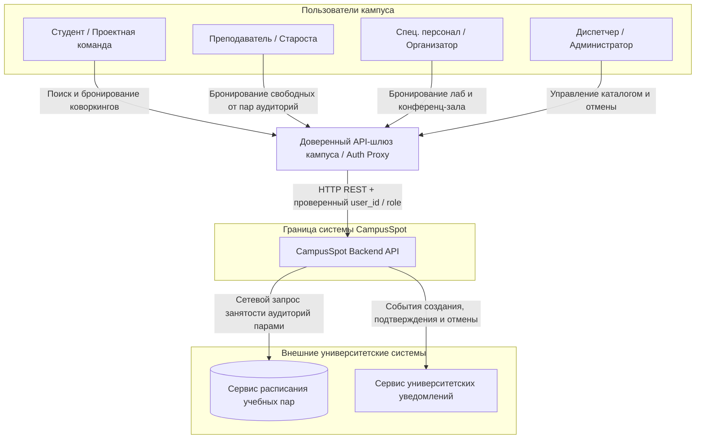
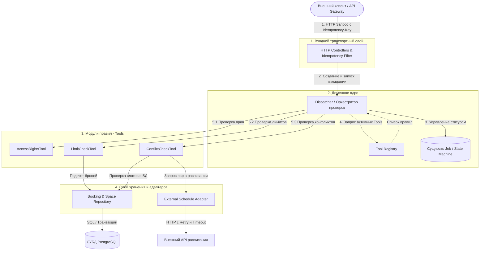

# Архитектура системы CampusSpot (architecture.md)

Документ описывает архитектуру серверного сервиса **CampusSpot** на уровнях контекста (C4 Context), компонентов (C4 Component), подробного описания внутренних модулей и модели состояний единицы работы (`Job`).

---

## 1. Контекстная схема системы (C4 Context)

Схема показывает границы системы CampusSpot, роли пользователей кампуса и внешние университетские сервисы.

## 2. Компонентная схема системы (C4 Component)

Схема показывает декомпозицию бэкенда CampusSpot на четкие слои: входной слой, доменное ядро (`Dispatcher` + `Registry`), конвейер инструментов (`Tools`) и инфраструктурные адаптеры.

# 3. Подробное описание компонентов системы

Внутренняя архитектура построена по принципу модульного конвейера (Pipeline), где проверка каждого бизнес-правила изолирована в отдельном независимом компоненте.

## 3.1. Входной слой (HTTP Controllers & Idempotency Filter)

- **Назначение:** принимает внешние HTTP-запросы от шлюза кампуса, производит десериализацию JSON, первичную валидацию типов и форматов дат.
- **Фильтр идемпотентности (Idempotency Filter):** перехватывает заголовок `Idempotency-Key`. При повторном запросе с тем же ключом и тем же телом запрос не передается на повторную обработку в ядро, а сразу возвращает сохраненный результат предыдущей операции (защита от дублирования броней при нестабильном Wi-Fi кампуса).

## 3.2. Доменная сущность заявки (Job & State Machine)

- **Назначение:** представляет единицу бронирования в системе. Содержит идентификатор `job_id`, целевое пространство `space_id`, временной интервал (`start_time`, `end_time`), инициатора (`user_id`, `role`), текущий статус и историю валидации.
- **Инкапсулированная стейт-машина:** контролирует допустимость перехода между статусами (`REQUESTED`, `CONFIRMED`, `USED`, `CANCELLED`, `EXPIRED`) и блокирует любые некорректные операции на уровне доменной логики.

## 3.3. Оркестратор проверок (Dispatcher)

- **Назначение:** управляет процессом проверки созданной заявки. Не содержит в себе конкретных бизнес-правил, а запрашивает их список у Реестра (Tool Registry).
- **Логика работы:** последовательно передает `Job` в каждый полученный `Tool`. Если очередной инструмент возвращает отказ, Диспетчер немедленно прерывает пайплайн (fail-fast), переводит заявку в статус `CANCELLED` с сохранением причины и возвращает ошибку. Если все инструменты ответили успехом — заявка переводится в `CONFIRMED`.

## 3.4. Реестр инструментов (Tool Registry)

- **Назначение:** служит каталогом (реестром) зарегистрированных в системе инструментов проверки.
- **Масштабируемость:** реализует паттерн «Реестр» (Registry). Для добавления нового правила бронирования в систему достаточно реализовать интерфейс `Tool` и зарегистрировать его в Registry. При этом код самого Dispatcher не модифицируется (соблюдение принципа Open/Closed).

## 3.5. Модули бизнес-правил (Tools)

Каждый инструмент реализует единый интерфейс с методом `execute(job: Job) -> ToolResult`:

1. **AccessRightsTool (проверка прав доступа):** проверяет соответствие роли пользователя (`student`, `teacher`, `special_staff`, `admin`) категории запрашиваемого помещения (коворкинги доступны всем, лаборатории и зал на 700 мест — только спецперсоналу).
2. **LimitCheckTool (контроль лимитов):** проверяет соблюдение ограничений кампуса: длительность одной брони не более 4 часов (240 минут) и суммарное количество активных броней у одного пользователя не более 2.
3. **ConflictCheckTool (проверка накладок):** проверяет пересечение слота времени. Для аудиторий опрашивает адаптер расписания пар, а также проверяет отсутствие других подтвержденных броней в репозитории.

## 3.6. Слой хранения данных (Repository & Database)

- **Назначение:** обеспечивает персистентность данных. Сохраняет каталоги помещений, заявки `Job`, их статусы и результаты выполнения проверок (`ToolResult`).
- **Изоляция:** скрывает детали SQL-диалекта PostgreSQL, управление соединениями, транзакционную изоляцию и наложение блокировок от состояния гонки (Race Condition).

## 3.7. Адаптер внешней интеграции (External Adapter)

- **Назначение:** выступает антикоррупционным слоем (Anti-Corruption Layer) между внутренним ядром CampusSpot и нестабильными внешними университетскими API (расписание занятий и сервис рассылки уведомлений).
- **Отказоустойчивость:** инкапсулирует логику повторных попыток (retry), экспоненциальную задержку (backoff), строгие сетевые таймауты и маппинг внешних DTO во внутренние доменные структуры.

# 4. Ответственность и границы сокрытия компонентов (Encapsulation)

Строго по одной строке на каждый компонент согласно требованиям курса:

- **Входной слой (HTTP Controllers & Idempotency Filter):**
  - *За что отвечает:* принимает внешние HTTP-запросы, валидирует входные DTO и фильтрует дубли по `Idempotency-Key`.
  - *Что скрывает от соседей:* формат протокола HTTP, заголовки, разбор JSON и специфику формирования HTTP-статусов.

- **Оркестратор проверок (Dispatcher):**
  - *За что отвечает:* координирует последовательный прогон заявки `Job` по инструментам проверки до первого отказа либо до подтверждения.
  - *Что скрывает от соседей:* алгоритм обхода валидаторов, логику остановки конвейера и агрегацию промежуточных результатов.

- **Реестр инструментов (Tool Registry):**
  - *За что отвечает:* хранит и предоставляет список активных валидаторов (Tools) по запросу Диспетчера.
  - *Что скрывает от соседей:* способ создания, конфигурирования и внедрения зависимостей (DI) в конкретные классы правил.

- **Инструменты бизнес-правил (ConflictCheck, LimitCheck, AccessRights):**
  - *За что отвечают:* изолированно проверяют одно бизнес-правило (права роли, лимит 4 часов / 2 броней, занятость слота).
  - *Что скрывают от соседей:* внутренние константы политик, критерии сопоставления интервалов и списки разрешенных категорий.

- **Репозиторий хранилища (Repository):**
  - *За что отвечает:* выполняет сохранение и выборку сущностей Space, Job и истории проверок в базе данных.
  - *Что скрывает от соседей:* SQL-запросы, схему таблиц базы данных, транзакции, блокировки строк и драйвер СУБД.

- **Адаптер внешней интеграции (External Adapter):**
  - *За что отвечает:* сетевое взаимодействие с внешним расписанием учебных пар и университетским сервисом уведомлений.
  - *Что скрывает от соседей:* внешние сетевые URL, таймауты сокетов, политику повторов (retry) и обработку сбоев сети.
