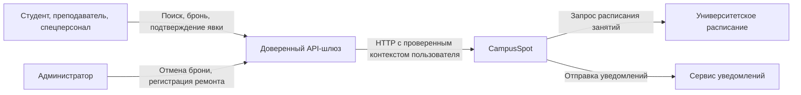
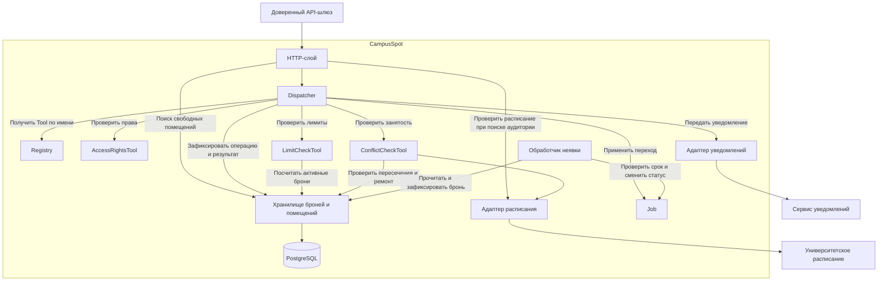

# Архитектура CampusSpot

## Контекст

Стрелки показывают обращения во время работы системы, от инициатора к получателю. Студенты, преподаватели и спецперсонал обращаются к одному API с разными правами.

## Компоненты

Стрелки показывают вызовы во время выполнения, от вызывающего компонента к вызываемому. Ветви от Dispatcher к Tool обозначают отдельные проверки: при создании брони Dispatcher выполняет их последовательно до первого отказа.

| Компонент | За что отвечает и что скрывает от соседей |
| --- | --- |
| HTTP-слой | Проверяет контекст шлюза и параметры запроса, преобразует их во внутренние данные. Скрывает HTTP-заголовки, JSON и формат ответа. |
| Dispatcher | Выбирает последовательность проверок и фиксирует результат операции. Скрывает порядок вызовов и обработку отказа. |
| Registry | Возвращает зарегистрированный Tool по имени. Скрывает способ хранения и регистрации инструментов. |
| Job | Проверяет и выполняет переходы между состояниями. Скрывает условия допустимости каждого перехода. |
| AccessRightsTool | Проверяет право роли на категорию помещения. Скрывает правила сопоставления ролей и категорий. |
| LimitCheckTool | Проверяет длительность и количество активных броней. Скрывает расчёт лимитов. |
| ConflictCheckTool | Проверяет пересечения с бронями, ремонтом и учебными парами. Скрывает правила сравнения интервалов. |
| Хранилище броней и помещений | Читает и сохраняет данные, ключи идемпотентности и результаты. Скрывает SQL, транзакции и блокировки. |
| PostgreSQL | Хранит зафиксированные изменения и обеспечивает атомарность транзакции. Скрывает способ записи и восстановления данных. |
| Адаптер расписания | Получает занятость аудиторий. Скрывает внешний формат данных, таймауты и повторы запроса. |
| Адаптер уведомлений | Передаёт сообщения университетскому сервису. Скрывает сетевой протокол и формат сообщения. |
| Обработчик неявки | Освобождает слот при истечении срока явки. Скрывает от клиента запуск фоновой проверки. |

Все проверки используют [контракт Tool](tool-contract.md) с методом `execute(params: ToolParams) -> ToolResult`. При создании брони предметный отказ переводит её в `CANCELLED`. При неудачном переносе или продлении существующая бронь сохраняет статус и интервал.

При повторе операции с обязательным `Idempotency-Key` сервис проверяет полномочия пользователя и отпечаток запроса. После успешной операции тот же ключ и отпечаток возвращают сохранённый ответ. Для другого отпечатка под тем же ключом предусмотрен `409 IDEMPOTENCY_KEY_PAYLOAD_MISMATCH`. [ADR-0002](adr/0002-idempotency-protection.md)

[Диаграмма состояний Job и ответы на запрещённые переходы](jobs.md)
