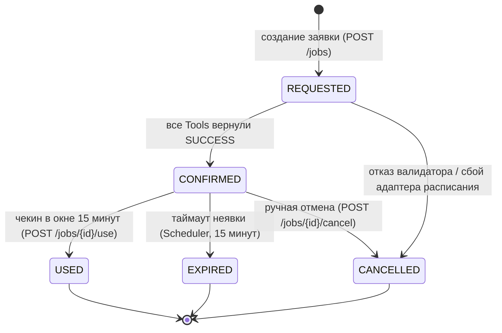

# Жизненный цикл и диаграмма состояний сущности Job

Сущность `Job` представляет собой единицу работы системы — заявку на бронирование пространства кампуса. Жизненный цикл строго управляется конечным автоматом (Finite State Machine, FSM).

---

## 1. Диаграмма состояний (Mermaid stateDiagram-v2)

---

## 2. Описание состояний и разрешённые переходы

Список всех состояний:

- **REQUESTED** — начальное состояние. Заявка зарегистрирована во входном контроллере, сохранена с ключом идемпотентности и передана в Dispatcher для запуска пайплайна валидации.
- **CONFIRMED** — активное подтвержденное состояние. Все инструменты проверки (AccessRightsTool, LimitCheckTool, ConflictCheckTool) подтвердили возможность бронирования. Слот зарезервирован.
- **USED** — терминальное состояние. Пользователь явился на место и подтвердил начало работы через API в течение допустимого 15-минутного окна.
- **CANCELLED** — терминальное состояние. Заявка аннулирована либо до подтверждения (отказ валидаторов Tools), либо после подтверждения по инициативе автора/администратора, либо из-за экстренной отмены при изменении учебного расписания.
- **EXPIRED** — терминальное состояние. Пользователь не выполнил Check-in в течение первых 15 минут от времени старта слота. Фоновый воркер-планировщик освободил слот.

---

Разрешённые переходы:

| № | Исходное состояние | Конечное состояние | Инициатор (триггер) | Описание бизнес-события |
|---|---|---|---|---|
| 1 | `[*]` | `REQUESTED` | Пользователь (HTTP API) | Вызов `POST /jobs` с заголовком `Idempotency-Key` и параметрами брони. |
| 2 | `REQUESTED` | `CONFIRMED` | Dispatcher (ядро) | Все Tools вернули статус SUCCESS (права есть, лимиты не превышены, конфликтов в расписании пар нет). |
| 3 | `REQUESTED` | `CANCELLED` | Dispatcher (ядро) | Хотя бы один Tool вернул отказ (например, пара в аудитории) либо внешний сервис расписания вернул ошибку после всех retry. |
| 4 | `CONFIRMED` | `USED` | Пользователь (HTTP API) | Студент вызвал `POST /jobs/{id}/use` во временном окне: `[start_time; start_time + 15 min]`. |
| 5 | `CONFIRMED` | `EXPIRED` | Фоновый Scheduler | Прошло более 15 минут от старта слота, а статус остался `CONFIRMED`. Слот освобождается. |
| 6 | `CONFIRMED` | `CANCELLED` | Пользователь / Диспетчер | Вызов `POST /jobs/{id}/cancel` до наступления времени брони или принудительная отмена диспетчером. |

---

## 3. Запрещённые переходы и реакция системы

Состояния `USED`, `CANCELLED` и `EXPIRED` являются терминальными (конечными). Выход из них или изменение статуса строго запрещены на уровне бизнес-логики доменного ядра.

При любой попытке совершить недопустимый переход доменная стейт-машина прерывает выполнение операции транзакции, состояние в базе данных не изменяется, а API возвращает клиенту HTTP-статус **409 Conflict** с машиночитаемым кодом ошибки и поясняющим сообщением:

| Попытка перехода | Ситуация / причина запрета | Код ответа | Тело ответа системы (JSON) |
|---|---|---|---|
| `USED` → `CANCELLED` | Попытка отменить бронь после того, как студент уже подтвердил присутствие и занял место. | 409 Conflict | `{"error": "INVALID_STATE_TRANSITION", "message": "Невозможно отменить бронь: помещение уже используется.", "current_status": "USED", "target_status": "CANCELLED"}` |
| `EXPIRED` → `USED` | Попытка чекина с опозданием (более чем через 15 минут после начала слота). Слот уже аннулирован. | 409 Conflict | `{"error": "BOOKING_EXPIRED", "message": "Время на подтверждение явки (15 минут) истекло. Бронь аннулирована.", "current_status": "EXPIRED", "target_status": "USED"}` |
| `CANCELLED` → `CONFIRMED` | Попытка «восстановить» или реактивировать отмененную ранее бронь. | 409 Conflict | `{"error": "INVALID_STATE_TRANSITION", "message": "Отмененная заявка не подлежит повторному подтверждению.", "current_status": "CANCELLED", "target_status": "CONFIRMED"}` |
| `USED` → `CONFIRMED` | Попытка обратного отката из использованного состояния в подтвержденное. | 409 Conflict | `{"error": "INVALID_STATE_TRANSITION", "message": "Недопустимый откат статуса из терминального состояния USED.", "current_status": "USED", "target_status": "CONFIRMED"}` |
| `REQUESTED` → `USED` | Попытка выполнить Check-in в заявку, которая еще проходит конвейер проверок Tools и не подтверждена. | 409 Conflict | `{"error": "JOB_NOT_CONFIRMED", "message": "Нельзя использовать бронь до завершения валидации и подтверждения.", "current_status": "REQUESTED", "target_status": "USED"}` |
| `REQUESTED` → `EXPIRED` | Попытка перевода по таймауту неявки заявки, которая еще находится в процессе обработки. | 409 Conflict | `{"error": "INVALID_STATE_TRANSITION", "message": "Таймаут явки применим только к подтвержденным броням.", "current_status": "REQUESTED", "target_status": "EXPIRED"}` |
| `EXPIRED` → `CANCELLED` | Попытка пользователя отменить бронь, которая уже списана в `EXPIRED` планировщиком. | 409 Conflict | `{"error": "INVALID_STATE_TRANSITION", "message": "Бронь уже аннулирована по неявке и не может быть отменена вручную.", "current_status": "EXPIRED", "target_status": "CANCELLED"}` |
